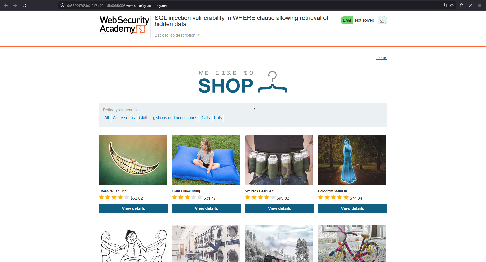
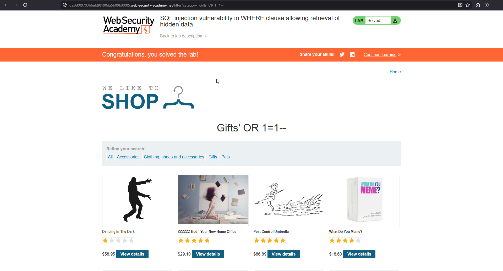

# SQL injection in WHERE clause allowing retrieval of hidden data

**Lab:** PortSwigger Web Security Academy — *SQL injection vulnerability in WHERE clause allowing retrieval of hidden data* (Apprentice).

> The application lets you filter products by category. When you select a category, the browser requests `/filter?category=Gifts`. Behind the scenes the app runs a SQL query to fetch the matching, released products. The goal is to make it return **all** products, including ones that are not released.

## 1. Understand the normal query

Selecting the **Gifts** category sends:

```text
GET /filter?category=Gifts
```

The backend builds a query roughly like:

```sql
SELECT * FROM products WHERE category = 'Gifts' AND released = 1
```

Two conditions must both be true: the category matches, and `released = 1` (so unreleased products stay hidden).



## 2. Inject into the category parameter

Set the `category` value to `Gifts' OR 1=1--`:

```text
GET /filter?category=Gifts' OR 1=1--
```

The query the database receives becomes:

```sql
SELECT * FROM products WHERE category = 'Gifts' OR 1=1--' AND released = 1
```

Breaking that down:

- The `'` closes the `Gifts` string.
- `OR 1=1` makes the `WHERE` clause true for **every** row (`1=1` is always true).
- `--` comments out the rest of the original query, including `AND released = 1`, so the released-only filter is discarded.

## 3. Confirm all products are returned

The response now lists every product in the catalogue — including unreleased items that were previously hidden — and the lab is solved.



## Why the attack works

The application concatenates the category value straight into the SQL string, so the input is parsed as SQL rather than treated as a literal category name. `OR 1=1` overrides the intended filtering logic, and the comment sequence deletes the `released = 1` guard that was supposed to hide unreleased products.

## Remediation

Use a parameterised query so the category is bound as data and can never change the query structure:

```sql
SELECT * FROM products WHERE category = ? AND released = 1
```

With the value bound as a parameter, `Gifts' OR 1=1--` is treated as a (non-existent) category name and simply returns nothing.
